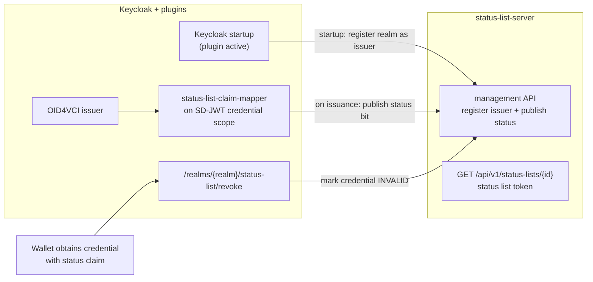

# Issue and Revoke Credentials with a Token Status List server

This guide shows how to **issue and revoke credentials** with the Keycloak
OID4VC issuer in this repository, end to end, entirely on your local machine with Docker.
Once issued, a credential can be revoked (for example because it was compromised), and
its current status is published on a dedicated status list server. A status-aware
verifier that fetches and validates that status list will reject a revoked credential.

The flow combines three components:

- **Keycloak**: the OID4VC issuer that issues the credentials.
- **The [Keycloak Token Status plugin](https://github.com/ADORSYS-GIS/token-status-link)**:
  the plugin that registers the realm as an issuer on the status list server, adds the
  `status` claim to issued credentials, and serves the revocation endpoint.
- **The [status list server](https://github.com/adorsys/status-list-server)**: the service
  that stores and publishes the [OAuth Token Status List](https://datatracker.ietf.org/doc/draft-ietf-oauth-status-list/)
  tokens used to check revocation.

## Contents

- [How it works](#how-it-works)
- [Prerequisites](#prerequisites)
- [Start everything with Docker](#start-everything-with-docker)
- [Configuration](#configuration)
- [Exercise the revocation flow](#exercise-the-revocation-flow)
- [Turning it off](#turning-it-off)
- [Compatibility & troubleshooting](#compatibility--troubleshooting)

## How it works



1. **Provision the plugin.** The status list feature is **opt-in**: set
   `status_list.enabled: true` in `config.override.yaml` (the guide's step 1 does this).
   When enabled, the `keycloak-ssi config` step enables the plugin at the realm level by
   setting the realm attributes (`status-list-enabled=true`, `status-list-server-url` and
   a deterministic `status-list-token-issuer-prefix`), requires the plugin JAR in
   `./providers` and fails fast if it is missing. The enabled **SD-JWT** credential scopes
   then automatically get the `oid4vc-status-list-claim-mapper` protocol mapper and expose
   the `status` claim. Deployments that do not opt in are unaffected.
2. **Registration (Keycloak startup).** When Keycloak starts with the plugin installed and
   the realm attributes set, the plugin registers the realm as an issuer on the status list
   server, bound to the realm's active credential-signing key. This is a background
   operation performed once per Keycloak startup, which is why the flow below restarts
   Keycloak after `config` before issuing: the restart guarantees the registration binds
   the final signing key, not a pre-configuration default.
3. **Issuance.** When Keycloak issues a credential, the mapper publishes the credential's
   status bit to the status list server (which stores the status list) and adds a `status`
   claim to the credential pointing at the status list.
4. **Revocation.** A client calls Keycloak's `/realms/{realm}/status-list/revoke` endpoint,
   which sets the credential's status to `INVALID` in the status list. A status-aware
   verifier that later fetches and validates that status list will treat the credential
   as revoked.

The plugin's full configuration reference and HTTP endpoints are documented in the
[plugin technical reference](https://github.com/ADORSYS-GIS/token-status-link).

## Prerequisites

- Docker + Docker Compose v2.20.0+.
- The `keycloak-ssi` prerequisites used by this repository's main flow
  (`keycloak-ssi help` / `docs/CLI_GUIDE.md`): JDK 17+, `openssl`, `keytool`, `jq`, `yq`.
- The **Token Status plugin JAR** in `./providers` (see below).
- Internet access on the first run to pull the container images.

### Version compatibility

The integration requires Keycloak and the plugin to be compatible. The plugin is verified
against **Keycloak 26.8.0**. If your deployment still uses an older tag, point it at a
compatible version:

```bash
# config.override.yaml
keycloak_image:
  tag: "26.8.0"
```

The tested and verified combination is the **token-status-link plugin 0.5.2** with the
**status list server image v1.2.0-memory**. Keep `status_list.plugin_version` and `status_list.image` on a
tested pair and re-test the flow after upgrading either one.

## Start everything with Docker

From the `oid4vci-deployment` directory:

1. Enable the pre-authorized code flow this guide relies on and opt in to the status
   list feature (both are off by default). Save this as `config.override.yaml` (or merge
   these keys into an existing one):

```yaml
keycloak:
  enable_preauth_code: true
  enable_rest_credential_offer: true
  enable_credential_offer_create: true

status_list:
  enabled: true
  server_url: "http://status-list-server:8000"
```

2. Install the Token Status plugin and start the stack:

```bash
curl -fL -o providers/keycloak-token-status-plugin-0.5.2.jar \
  https://repo1.maven.org/maven2/io/github/adorsys-gis/keycloak-token-status-plugin/0.5.2/keycloak-token-status-plugin-0.5.2.jar

# 3) Start Keycloak, Postgres and the status list server together. The status list
#    server image (status_list.image) is pulled from the registry.
./keycloak-ssi.sh compose --profile status-list up -d

# `up -d` returns before Keycloak is ready, and `config` exits when Keycloak is
# not reachable yet. Wait until the realm endpoint responds:
until curl -k -sf https://localhost:8443/realms/master > /dev/null; do sleep 2; done

# 4) Configure realm, credential scopes, users and the status-list plugin
./keycloak-ssi.sh config

# 5) Restart Keycloak so the Token Status plugin registers the realm as an issuer
#    on the status list server. The plugin's startup health check is reliable, so
#    this step is required before issuing.
./keycloak-ssi.sh compose up -d --force-recreate app

# Registration runs in the background after Keycloak starts, so wait for it
# here (up to ~60s) instead of checking the log once:
for _ in $(seq 1 30); do
  docker logs oid4vci-deployment-app-1 2>&1 | grep "Successfully registered realm as issuer" && break
  sleep 2
done
```

The `--profile status-list` profile starts all of the services at once: the Keycloak
`app`, the Postgres `db`, and the `status-list-server` (pulled from the registry).

Keycloak is available at `https://localhost:8443` (admin `admin`/`admin`). The status
list server listens on a single port:

| Port | Listener                                                                                 |
| ---- | ---------------------------------------------------------------------------------------- |
| 8000 | Public status lists, management API (issuer registration, status publication) and health |

With Compose, Keycloak reaches the server at the container service name
(`status_list.server_url: http://status-list-server:8000`, the default); if you run
Keycloak outside Compose (tarball/`keycloak-ssi setup`), point the URL at the published
host port (`http://localhost:8000`). Credentials carry their status URI as built from
that URL, so the URI only resolves inside the Compose network; a wallet or verifier
outside the network must use the published host port instead. The server signs its status
lists with the demo key and certificate under `certs/status-list/`, which is disposable
local-demo material: never use it outside local development, non-local setups need their
own protected signing key and certificate.

## Configuration

Everything the deployment applies is driven by `config.yaml`; override values with a
`config.override.yaml` (see the Configuration Model in the `Readme.md`). Note that host
environment variables such as `STATUS_LIST_ENABLED=true` do **not** override these
settings for the `config` command: the CLI exports the merged YAML values, and (when
running inside the Compose `cli` container) host variables are not passed through. Enable
the feature by setting `status_list.enabled: true` in `config.override.yaml`:

| Key                          | Default                                            | Purpose                                                                 |
| ---------------------------- | -------------------------------------------------- | ----------------------------------------------------------------------- |
| `status_list.enabled`        | `false`                                            | Opt in to the plugin + status claim emission at the realm level         |
| `status_list.server_url`     | `http://status-list-server:8000`                   | Status list server URL as seen by Keycloak                              |
| `status_list.plugin_version` | `0.5.2`                                            | Pinned plugin version (documentation/installation)                      |
| `status_list.image`          | `ghcr.io/adorsys/status-list-server:v1.2.0-memory` | Status list server image (built from `main` with the in-memory feature) |

When enabled, the config step performs two things:

1. Sets realm attributes **`status-list-enabled=true`** and
   **`status-list-server-url=<status_list.server_url>`**.
2. Attaches the **`oid4vc-status-list-claim-mapper`** protocol mapper and adds the
   `status` claim to the enabled **SD-JWT** credential client scopes
   (`IdentityCredential`, `KMACredential`, `SteuerberaterCredential`), so issued
   credentials carry a status list reference.

For advanced options (per-credential quotas, overflow policy, mandatory publication,
TLS trust), see the [plugin configuration properties](https://github.com/ADORSYS-GIS/token-status-link).

## Exercise the revocation flow

### 1. Issue a credential

```bash
./keycloak-ssi.sh test preauth IdentityCredential
```

### 2. Verify the status claim is in the credential

The test prints the credential endpoint's JSON response. Save it into a file (for example
`response.json`), extract the SD-JWT from the `credentials[0].credential` field, and decode
the payload with the URL-safe alphabet and padding restored, since the JWT segments are
base64url encoded:

```bash
# Extract the SD-JWT from the credential response, then decode the payload and show the status claim
jq -r '.credentials[0].credential | split(".")[1] | gsub("-";"+") | gsub("_";"/") | . + ("=" * ((4 - length % 4) % 4)) | @base64d' response.json | jq '.status'
```

Expected output (the URI is a Compose network internal address, see above):

```json
{
  "status_list": {
    "idx": 0,
    "uri": "http://status-list-server:8000/api/v1/status-lists/<list_id>"
  }
}
```

### 3. Query the credential's current status

Get a token for the demo user and list the issued credentials:

```bash
TOKEN=$(curl -k -s -X POST https://localhost:8443/realms/oid4vc-vci/protocol/openid-connect/token \
  -d "grant_type=password&client_id=oid4vc-demo-public&username=francis&password=francis" | jq -r .access_token)

curl -k -s -H "Authorization: Bearer $TOKEN" \
  https://localhost:8443/realms/oid4vc-vci/status-list/issued-credential-status \
  | jq '.credentials | sort_by(.issuedAt) | last | {credentialId, credentialType, status, mappingStatus}'
```

The newest entry (the credential issued in step 1) reports `status: "VALID"` (and
`mappingStatus: "SUCCESS"`).

### 4. Revoke the credential

The endpoint lists all issued credentials, including older ones from previous runs (the
Compose database persists between runs). The credential you issued in step 1 is the most
recently issued one, so select it by the newest `issuedAt` timestamp and revoke it with
`mode=issued_credential_revocation`:

```bash
CREDENTIAL_ID=$(curl -k -s -H "Authorization: Bearer $TOKEN" \
  https://localhost:8443/realms/oid4vc-vci/status-list/issued-credential-status \
  | jq -r '.credentials | sort_by(.issuedAt) | last | .credentialId')
echo "Revoking credential: $CREDENTIAL_ID"

curl -k -s -X POST \
  -H "Authorization: Bearer $TOKEN" \
  -d "mode=issued_credential_revocation&credential_id=$CREDENTIAL_ID&reason=compromised" \
  https://localhost:8443/realms/oid4vc-vci/status-list/revoke \
  | jq
```

### 5. Confirm the credential is now revoked

Query the status again for that credential:

```bash
curl -k -s -H "Authorization: Bearer $TOKEN" \
  https://localhost:8443/realms/oid4vc-vci/status-list/issued-credential-status \
  | jq --arg id "$CREDENTIAL_ID" '.credentials[] | select(.credentialId == $id) | {credentialId, status, mappingStatus}'
```

The status is now `INVALID`. Optionally fetch the signed status list token the credential
points to, using the `list_id` from its `uri` shown in step 2:

```bash
curl -s -H "Accept: application/statuslist+jwt" \
  "http://localhost:8000/api/v1/status-lists/<list_id>" -o statuslist.jwt
```

**What happens:** revocation flips the credential's bit to `INVALID` in the status list it
points to and republishes the signed list. It does not stop a wallet from presenting the
credential: a status-aware **verifier** that fetches the status list, validates its
signature against the issuer's trusted signing certificate, and checks the presented
credential's `status` claim is what actually rejects it. This guide verifies the
revocation through the plugin's local status API and the published list itself;
demonstrating verifier-side rejection is out of scope.

## Turning it off

The feature is off by default. To disable it after enabling, remove the `status_list`
block (or set `status_list.enabled: false`) from `config.override.yaml` and re-run
`keycloak-ssi config`. The config step then applies the realm attributes without the
status-list entries (realm attribute updates replace the whole attribute map, so the
previously set `status-list-enabled`, `status-list-server-url` and
`status-list-token-issuer-prefix` attributes are removed automatically) and creates
credential scopes without the status mapper.

Already-created scopes are skipped on re-configuration, so they keep the
`status-list-claim-mapper` mapper and the `status` entry in
`vc.credential_build_config.sd_jwt.visible_claims`. Remove them through the Admin REST
API before re-using the realm without the feature:

```bash
# Admin token for the Admin REST API (admin/admin is the local demo default)
ADMIN_TOKEN=$(curl -k -s -X POST https://localhost:8443/realms/master/protocol/openid-connect/token \
  -d "grant_type=password&client_id=admin-cli&username=admin&password=admin" | jq -r .access_token)
BASE="https://localhost:8443/admin/realms/oid4vc-vci"

# For each remaining SD-JWT scope, remove the status mapper and the status entry
curl -k -s -H "Authorization: Bearer $ADMIN_TOKEN" "$BASE/client-scopes" \
  | jq -c '.[] | select(.protocolMappers[]?.protocolMapper == "oid4vc-status-list-claim-mapper")' \
  | while read -r scope; do
      SCOPE_ID=$(jq -r '.id' <<< "$scope")
      MAPPER_ID=$(jq -r '.protocolMappers[] | select(.protocolMapper == "oid4vc-status-list-claim-mapper") | .id' <<< "$scope")
      # 1) delete the status-list claim mapper (mapper endpoints live under /models)
      curl -k -s -o /dev/null -w "DELETE mapper: HTTP %{http_code}\n" -X DELETE -H "Authorization: Bearer $ADMIN_TOKEN" \
        "$BASE/client-scopes/$SCOPE_ID/protocol-mappers/models/$MAPPER_ID"
      # 2) PUT the scope back with the mapper filtered out and the status entry
      #    dropped from the visible claims; otherwise the update would re-add it
      curl -k -s -o /dev/null -w "PUT scope: HTTP %{http_code}\n" -X PUT -H "Authorization: Bearer $ADMIN_TOKEN" \
        -H "Content-Type: application/json" \
        -d "$(jq 'del(.protocolMappers[] | select(.protocolMapper == "oid4vc-status-list-claim-mapper"))
                  | .attributes["vc.credential_build_config.sd_jwt.visible_claims"] |=
                     (split(",") | map(select(gsub("^\\s+|\\s+$"; "") != "status")) | join(","))' <<< "$scope")" \
        "$BASE/client-scopes/$SCOPE_ID"
    done
```

## Compatibility & troubleshooting

- **Plugin not active / no `status` claim in credentials.** Check that the JAR is in
  `./providers`, that Keycloak was restarted after adding it, and that
  `status_list.enabled=true` was applied (`status-list-enabled` realm attribute). Watch
  the Keycloak log for the plugin's registration messages:
  `--log-level=INFO,io.github.adorsysgis.keycloakstatuslist:DEBUG`. Realms configured
  before this feature keep their existing scopes without the mapper: the cleanest remedy
  is a realm recreation via `./keycloak-ssi.sh compose down -v` (this removes **all**
  stored Keycloak data, not just the realm) followed by re-running the guide, or attach
  `oid4vc-status-list-claim-mapper` manually.
- **Server not reachable from Keycloak.** Confirm `status_list.server_url` resolves from
  the Keycloak container. With Compose use `http://status-list-server:8000`; with a host
  Keycloak use `http://localhost:8000`.
- **Issuance fails.** Status publication is non-fatal by default
  (the realm attribute `status-list-mandatory=false`). If you set it to `true`, a failing
  status list server will block issuance. Change it back while debugging.
- **Status publication fails with `401 jwt_error`.** The issuer was registered with the
  wrong signing key, either before the credential-signing key was provisioned or from a
  realm snapshot taken during creation. Simply restarting Keycloak re-registers the
  issuer, but the server keeps the **first** key binding, so clear it too: restart the
  status list server (in-memory, so this clears all bindings) and then recreate Keycloak:
  `docker restart status-list-server && ./keycloak-ssi.sh compose up -d --force-recreate app`.
- **API contract / version mismatch.** The plugin registers the realm as an issuer
  with `POST /api/v1/credentials`. Keep `status_list.plugin_version` (0.5.2) and
  `status_list.image` (`...:v1.2.0-memory`, i.e. `main`) on a tested pair and re-run the
  flow after upgrading either one. Newer (develop-branch) server builds moved
  registration to an administrative API and will not work with this plugin.
- **Restarts and in-memory data.** The local status list server uses the in-memory
  backend, so its data is lost whenever the server process restarts, not only when the
  container is removed (this includes `docker compose up -d --force-recreate`,
  `restart`, and host reboots). Previously issued credentials keep pointing at list IDs
  the restarted server no longer knows, and re-registering the issuer does not restore
  those lists, so their status URIs no longer resolve. Re-issue credentials after any
  status list server restart.
