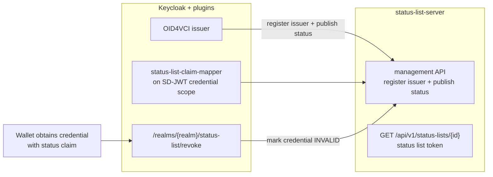

# Issue and Revoke Credentials with a Token Status List server

This guide shows how to **issue and revoke credentials** with the Keycloak
OID4VC issuer in this repository, end to end, entirely on your local machine with Docker.
Once issued, a credential can be revoked (for example because it was compromised), and
the current status is checked against a dedicated status list server so a revoked
credential can no longer be presented.

The flow combines three components:

- **Keycloak + the [Keycloak Token Status plugin](https://github.com/ADORSYS-GIS/token-status-link)**:
  the OID4VC issuer that reports each credential's status.
- **The [status list server](https://github.com/adorsys/status-list-server)**: the service
  that stores and publishes the [OAuth Token Status List](https://datatracker.ietf.org/doc/draft-ietf-oauth-status-list/)
  tokens used to check revocation.

## Contents

- [How it works](#how-it-works)
- [Prerequisites](#prerequisites)
- [Start everything with Docker](#start-everything-with-docker)
- [Configuration](#configuration)
- [Exercise the revocation flow](#exercise-the-revocation-flow)
- [Turning it off](#turning-it-off)
- [Compatibility & troubleshooting](#compatibility--troubleshooting)

## How it works



1. **Provision the plugin.** The `keycloak-ssi config` step enables the plugin at the
   realm level by setting two realm attributes (`status-list-enabled=true` and
   `status-list-server-url`). The enabled **SD-JWT** credential scopes automatically get
   the `oid4vc-status-list-claim-mapper` protocol mapper and expose the `status` claim.
   This only happens when `status_list.enabled` is `true` (it is by default), so
   deployments without the plugin are unaffected.
2. **Issuance.** When Keycloak issues a credential, the mapper publishes the credential's
   status bit to the status list server (which registers the Keycloak realm as an issuer
   and stores the status list) and adds a `status` claim to the credential pointing at
   the status list.
3. **Revocation.** A client calls Keycloak's `/realms/{realm}/status-list/revoke` endpoint,
   which sets the credential's status to `INVALID` in the status list. Anyone who later
   reads that status list sees the credential as revoked and will not accept it.

The plugin's full configuration reference and HTTP endpoints are documented in the
[plugin technical reference](https://github.com/ADORSYS-GIS/token-status-link).

## Prerequisites

- Docker + Docker Compose v2.
- The `keycloak-ssi` prerequisites used by this repository's main flow
  (`keycloak-ssi help` / `docs/CLI_GUIDE.md`): JDK 17+, `openssl`, `keytool`, `jq`, `yq`.
- The **Token Status plugin JAR** in `./providers` (see below).
- Internet access on the first run to pull the container images.

### Version compatibility

The integration requires Keycloak and the plugin to be compatible. The plugin is verified
against **Keycloak 26.8.0**. If your deployment still uses an older tag, point it at a
compatible version:

```bash
# config.override.yaml
keycloak_image:
  tag: "26.8.0"
```

The tested and verified combination is the **token-status-link plugin 0.5.2** with the
**status list server image v1.2.0-memory**. Keep `status_list.plugin_version` and `status_list.image` on a
tested pair and re-test the flow after upgrading either one.

## Start everything with Docker

From the `oid4vci-deployment` directory:

```bash
# 1) Install the Token Status plugin into ./providers before starting Keycloak
curl -fL -o providers/keycloak-token-status-plugin-0.5.2.jar \
  https://repo1.maven.org/maven2/io/github/adorsys-gis/keycloak-token-status-plugin/0.5.2/keycloak-token-status-plugin-0.5.2.jar

# 2) Start Keycloak, Postgres and the status list server together. The status list
#    server image (status_list.image) is pulled from the registry.
./keycloak-ssi.sh compose --profile status-list up -d

# 3) Configure realm, credential scopes, users and the status-list plugin
./keycloak-ssi.sh config

# 4) Restart Keycloak so the Token Status plugin registers the realm as an issuer
#    on the status list server. The plugin's startup health check is reliable, so
#    this step is required before issuing.
./keycloak-ssi.sh compose up -d --force-recreate app

# Confirm the realm registered as an issuer:
docker logs oid4vci-deployment-app-1 | grep "Successfully registered realm as issuer"
```

The `--profile status-list` profile starts all of the services at once: the Keycloak
`app`, the Postgres `db`, and the `status-list-server` (pulled from the registry).

Keycloak is available at `https://localhost:8443` (admin `admin`/`admin`). The status
list server listens on:

| Port | Listener            |
| ---- | ------------------- |
| 8000 | Public status lists |
| 8001 | Management          |
| 8002 | Admin / health      |

> **Note on the server URL.** With Compose, Keycloak reaches the server at the container
> service name: `status_list.server_url: http://status-list-server:8000` (the default).
> If you run Keycloak outside Compose (tarball/`keycloak-ssi setup`), point the URL at the
> published host port instead (`http://localhost:8000`).

## Configuration

Everything the deployment applies is driven by `config.yaml` (override with
`config.override.yaml` or environment variables `STATUS_LIST_*`):

| Key                          | Default                                            | Purpose                                                                 |
| ---------------------------- | -------------------------------------------------- | ----------------------------------------------------------------------- |
| `status_list.enabled`        | `true`                                             | Activate the plugin + status claim emission at the realm level          |
| `status_list.server_url`     | `http://status-list-server:8000`                   | Status list server URL as seen by Keycloak                              |
| `status_list.plugin_version` | `0.5.2`                                            | Pinned plugin version (documentation/installation)                      |
| `status_list.image`          | `ghcr.io/adorsys/status-list-server:v1.2.0-memory` | Status list server image (built from `main` with the in-memory feature) |

When enabled, the config step performs two things:

1. Sets realm attributes **`status-list-enabled=true`** and
   **`status-list-server-url=<status_list.server_url>`**.
2. Attaches the **`oid4vc-status-list-claim-mapper`** protocol mapper and adds the
   `status` claim to the enabled **SD-JWT** credential client scopes
   (`IdentityCredential`, `KMACredential`, `SteuerberaterCredential`), so issued
   credentials carry a status list reference.

For advanced options (per-credential quotas, overflow policy, mandatory publication,
TLS trust), see the [plugin configuration properties](https://github.com/ADORSYS-GIS/token-status-link).

## Exercise the revocation flow

### 1. Issue a credential

```bash
./keycloak-ssi.sh test preauth IdentityCredential
```

### 2. Verify the status claim is in the credential

Decode the SD-JWT returned by the test (paste it into [jwt.io](https://jwt.io), or decode the
payload locally) and confirm a `status` claim is present, pointing at a status list on the
server:

```bash
# Decode the payload of the SD-JWT from the test output and show the status claim
echo '<paste the SD-JWT here>' | cut -d'.' -f2 | base64 -d 2>/dev/null | jq '.status'
```

Expected output:

```json
{
  "status_list": {
    "idx": <index>,
    "uri": "http://status-list-server:8000/api/v1/status-lists/<list_id>"
  }
}
```

### 3. Query the credential's current status

Get a token for the demo user and list the issued credentials:

```bash
TOKEN=$(curl -k -s -X POST https://localhost:8443/realms/oid4vc-vci/protocol/openid-connect/token \
  -d "grant_type=password&client_id=oid4vc-demo-public&username=francis&password=francis" | jq -r .access_token)

curl -k -s -H "Authorization: Bearer $TOKEN" \
  https://localhost:8443/realms/oid4vc-vci/status-list/issued-credential-status \
  | jq '.credentials[] | {credentialId, credentialType, status, mappingStatus}'
```

The credential reports `status: "VALID"` (and `mappingStatus: "SUCCESS"`).

### 4. Revoke the credential

POST to the plugin's revocation endpoint with `mode=issued_credential_revocation` and the
`credential_id` (picked automatically from the first issued credential):

```bash
CREDENTIAL_ID=$(curl -k -s -H "Authorization: Bearer $TOKEN" \
  https://localhost:8443/realms/oid4vc-vci/status-list/issued-credential-status \
  | jq -r '.credentials[0].credentialId')

curl -k -s -X POST \
  -H "Authorization: Bearer $TOKEN" \
  -d "mode=issued_credential_revocation&credential_id=$CREDENTIAL_ID&reason=compromised" \
  https://localhost:8443/realms/oid4vc-vci/status-list/revoke \
  | jq
```

### 5. Confirm the credential is now revoked

Query the status again for that credential:

```bash
curl -k -s -H "Authorization: Bearer $TOKEN" \
  https://localhost:8443/realms/oid4vc-vci/status-list/issued-credential-status \
  | jq --arg id "$CREDENTIAL_ID" '.credentials[] | select(.credentialId == $id) | {credentialId, status, mappingStatus}'
```

The status is now `INVALID`. Optionally fetch the signed status list token the credential
points to (its `uri` from step 2) to see the update:

```bash
curl -s -H "Accept: application/statuslist+jwt" \
  http://localhost:8000/api/v1/status-lists/<list_id> -o statuslist.jwt
```

**What happens:** revocation flips the credential's bit to `INVALID` in the status list it
points to. Any verifier that fetches that status list will see the credential as revoked and
reject presenting it, so a revoked credential can no longer be used.

## Turning it off

To stop emitting status claims without removing the setup, set
`status_list.enabled: false` in `config.override.yaml` and re-run
`keycloak-ssi config`. The realm attributes are not applied and the credential scopes are
created without the status mapper, so normal issuance is unaffected.

## Compatibility & troubleshooting

- **Plugin not active / no `status` claim in credentials.** Check that the JAR is in
  `./providers`, that Keycloak was restarted after adding it, and that
  `status_list.enabled=true` was applied (`status-list-enabled` realm attribute). Watch
  the Keycloak log for the plugin's registration messages:
  `--log-level=INFO,io.github.adorsysgis.keycloakstatuslist:DEBUG`.
- **Server not reachable from Keycloak.** Confirm `status_list.server_url` resolves from
  the Keycloak container. With Compose use `http://status-list-server:8000`; with a host
  Keycloak use `http://localhost:8000`.
- **Issuance fails.** Status publication is non-fatal by default
  (the realm attribute `status-list-mandatory=false`). If you set it to `true`, a failing
  status list server will block issuance. Change it back while debugging.
- **API contract / version mismatch.** The plugin registers the realm as an issuer
  with `POST /api/v1/credentials`. Keep `status_list.plugin_version` (0.5.2) and
  `status_list.image` (`...:v1.2.0-memory`, i.e. `main`) on a tested pair and re-run the
  flow after upgrading either one. Newer (develop-branch) server builds moved
  registration to an administrative API and will not work with this plugin.
- **Restarts and in-memory data.** The local status list server uses the in-memory
  backend, so its data is gone after the container is removed. Restarting a fresh server
  is fine for a demo.
